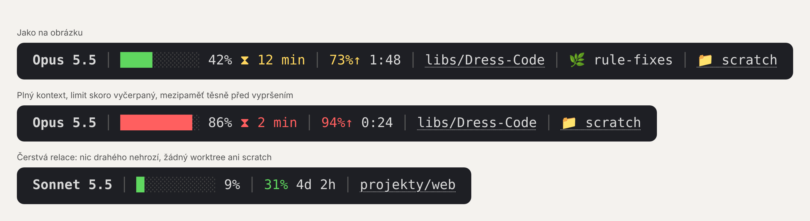

# Stavový řádek pro Claude

Plugin pro Claude Code, který na jeden řádek ukáže, co se právě děje:

```
Opus 5.5 │ ████░░░░░░ 42% ⧗ 12 min │ 73%↑ 1:48 │ libs/Dress-Code │ 🌿 rule-fixes │ 📁 scratch
```



| Segment | Co znamená |
| --- | --- |
| **Model** | Kdo právě odpovídá. |
| **Zaplnění paměti konverzace** | Zelená do 50 %, žlutá do 80 %, pak červená. Když dojde místo, Claude začne zapomínat detaily. |
| **⧗ Odpočet mezipaměti** | Za kolik minut mezipaměť vyprší. Další zpráva pak bude násobně dražší. Když nic drahého nehrozí, je tu prázdno. |
| **Vyčerpání předplatného** | Vždy to okno (5h nebo týdenní), které je nejblíž limitu. Šipka ↑ znamená, že spotřeba předbíhá čas. |
| **Obnovení limitu** | Za jak dlouho začne limit znovu od nuly: `1:48` nebo `3d 4h`. |
| **Projekt** | Kliknutím se otevře jeho složka. |
| **🌿 Git worktree** | Jen když se pracuje v oddělené kopii projektu. |
| **📁 Odkládací složka** | Pracovní soubory Clauda. Jen když v ní něco je; dá se na ni kliknout. |

## Instalace

V terminálu, v Claude Code:

```
/plugin install stavovy-radek --marketplace Kopei1979/stavovy-radek
```

Na otázku `Add marketplace?` odpověz `y` a pak Enterem potvrď rozsah **user** (platí pro všechny projekty).

Nebo rovnou z příkazové řádky:

```bash
claude plugin install stavovy-radek --marketplace Kopei1979/stavovy-radek
```

V desktopové aplikaci, kde `/plugin` nefunguje: klikni na **+** vedle pole pro zprávu → **Plugins** → **Add marketplace** → `Kopei1979/stavovy-radek` → **Add plugin**.

Plugin nainstalovaný z terminálu v rozsahu **user** se načte i v lokálních sezeních desktopové aplikace.

## Kde se co ukáže

- **Terminál:** plugin sám zapne stavový řádek dole pod promptem, nic se nenastavuje. Potřebuje Node.js 16+ (`node --version`). Bez Node.js se místo toho ukáže pruh nad promptem. Když už máš v nastavení vlastní `statusLine`, plugin ho nechá být.
- **Desktopová aplikace:** pruh nad polem pro zprávu.
- **Kdekoli, i na mobilu:** příkaz `/stav` otevře stavový řádek v panelu.
- **Klik na projekt nebo 📁 scratch** otevře v aplikaci panel s obsahem složky. V terminálu jde o odkaz (Ctrl/Cmd + klik) v terminálech, které odkazy umí: iTerm2, WezTerm, Kitty, Windows Terminal, terminál ve VS Code.

Limity předplatného ukazuje Claude Code jen u předplatného Pro a Max, a to až po první odpovědi v sezení.

## Aktualizace

```bash
claude plugin update stavovy-radek@stavovy-radek
```

## Vývoj

```bash
claude plugin validate .
claude plugin test .
```
